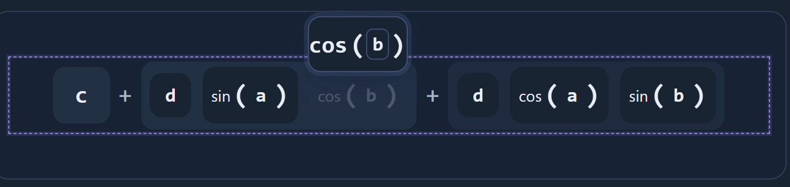
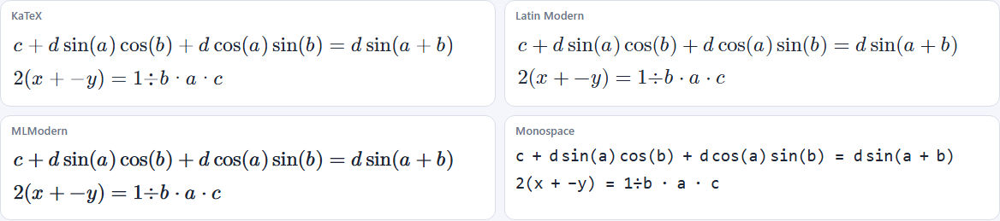
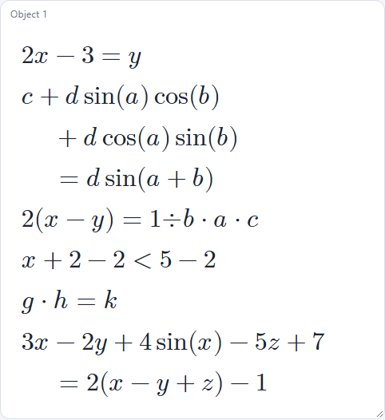
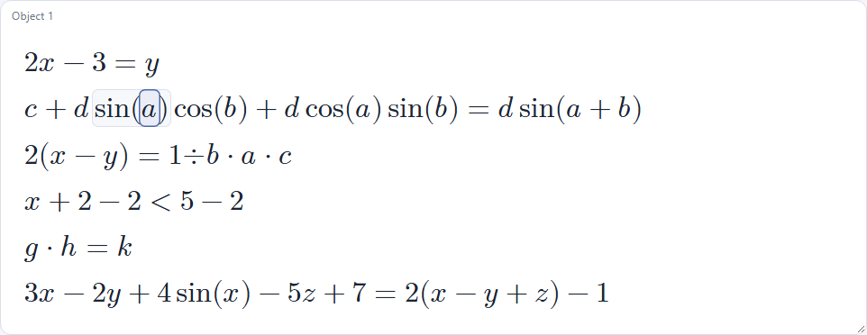
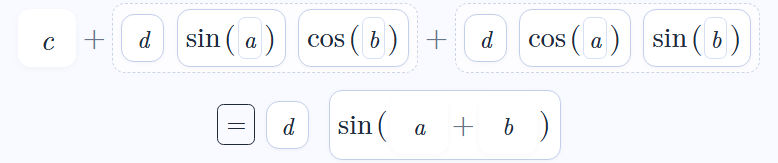
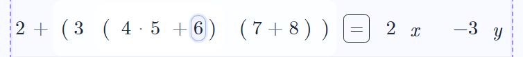
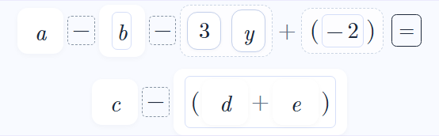
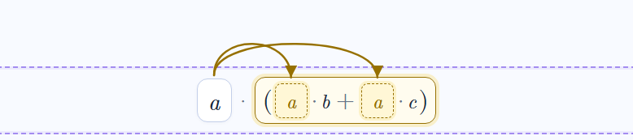
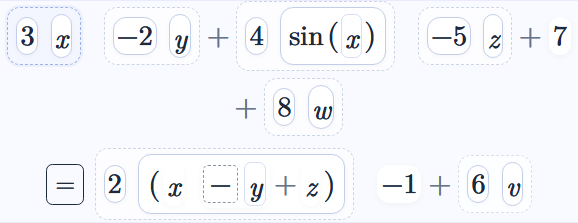

# Ideas overview: what matters now

**Status: a thinking page for the owner, 12 November 2026. Nothing here is decided unless it says so.** It gathers the open ideas and threads in one place, so the next steps can be chosen with the whole picture in view. Decided things are in [Decisions](../00_Current/Decisions.md), the state of the work in [Status](../00_Current/Status.md), and the longer proposals in [Future features](Future_Features.md) and the [statements and proofs draft](../02_Architecture/Engine_Statements_Draft.md).

## 1. Where we are

The foundation is in place: one path per job, definition objects (types, operators, relations, identities, gestures) added as one folder each, rules that ask for properties instead of assuming them, a table-driven parser, identities written as data, `<` and `>`, and multiplying both sides of an inequality with the sign question. Only real numbers exist as a type so far; E5 was meant to prove the design with a second type, a group, and this page steps back before doing that.

## 2. What a group could mean in the Manipulator

### Why have groups at all

A group is the first place where the design meets mathematics that is not ordinary arithmetic. That makes it useful in two ways:

- **For students:** it shows which familiar moves depend on which axioms. In a group you may regroup (associativity) and cancel with an inverse, but you may not reorder (no commutativity) and you may not "divide" (there is no single `g ÷ h`: `g·h⁻¹` and `h⁻¹·g` differ).
- **For the design:** it tests that the rules really ask for properties. Reordering should be refused with "this group is not commutative" without a single rule knowing what a group is.

### Possible features, smallest first

| Feature | What the student does | What it needs |
|---|---|---|
| Declare elements | Says that `g, h, k` are elements of a group G | Declarations and a type for each symbol |
| Write and read | `g h`, `g·h`, `g⁻¹`, `e` | A group operation's notation; an inverse written as a superscript; the identity as a constant |
| The axioms as moves | Regroup freely, cancel `g·g⁻¹` to `e`, remove `e`; reordering refused | Already designed: the rules ask for associative, inverses, identity, commutative |
| Both sides, left and right | From `g·x = h`, multiply both sides on the **left** by `g⁻¹` to get `x = g⁻¹·h` | Already present: multiply-left and multiply-right exist and are kept apart |
| Identities as data | `(g·h)⁻¹ = h⁻¹·g⁻¹` (socks and shoes), `(g⁻¹)⁻¹ = g` | Already present: one folder each, no code |
| Abelian groups | Declare G abelian; reordering is then allowed | A property set per declared group |
| Proofs from the axioms | Show that the identity is unique, or that `(gh)⁻¹ = h⁻¹g⁻¹` follows from the axioms | Statements that can be proved, and derived rules that show why |
| Concrete groups | Integers mod n, symmetries of a triangle, permutations; a Cayley table the Engine can check | Finite groups defined by a table (an owner idea from the statements draft) |
| Subgroups, homomorphisms, cosets | Later topics | Much more type machinery |

### Decisions a group needs (open)

1. **What a group is for, first:** practising moves that respect the axioms (the first five rows above), or proving small theorems, or concrete groups with tables.
2. **How elements are declared:** a typed line (`g, h \in G`), a type choice in the symbol table, a **window mode** (the statements draft's idea: each window chooses a mode such as algebra or groups, which sets the default types), or a combination.
3. **Notation:** juxtaposition `gh` or always `g·h`; the inverse typed as `g^-1` or `\inv(g)`; the identity as `e` or `1`.
4. **One operator or several:** today `Multiply` is one node whose properties come from the type. The statements draft records an earlier owner decision that **"an AST operator names its exact operation"** (scalar multiplication and matrix multiplication as different operators). For groups this means either the same `Multiply` node with the group's properties, or its own operator (say `GroupOperate`). This needs settling before E5, because it decides how the type system works for every later type.
5. **Abelian:** never, by declaration, or both kinds from the start.

## 3. Foundations a group would need (not built yet)

These are general, not group-specific; every later type (vectors, matrices) needs them too.

- **Declarations and type inference.** `typeOf` answers "scalar" for everything today. A declared symbol needs a type, and an expression's type must follow from its parts (a product of group elements is a group element; a scalar times a group element is refused).
- **Constants.** `e` (identity), and later `π`, `i`: names with a fixed meaning, not variables (also in the statements draft).
- **Notation that depends on the type.** `Invert` is drawn as `÷b` for scalars but should be `g⁻¹` in a group; the operation sign may differ too.
- **Powers.** `g⁻¹` and `g²` both want a power notation; powers read right to left (an owner decision already made).
- **Refusals that say why.** "This group is not commutative" needs the coordinator's missing-property report shown to the student (the report exists; the wording does not).

## 4. Other open threads in the project

| Thread | Ideas so far | Where |
|---|---|---|
| Statements and proofs | Axioms, basic theorems, higher theorems; a theorem is a derivation; derived rules that show why and can be earned; an axiomatic mode with `BinaryAdd` | [Statements draft](../02_Architecture/Engine_Statements_Draft.md), [Future features](Future_Features.md) |
| Assumptions | Recorded on steps today (`b ≠ 0`, `c < 0`); next: an assumptions panel whose status is calculated (true, unknown, false), warnings when later information breaks one | Statements draft |
| Uncertain steps | Statements that split into cases instead of asking; undefined values that stay but stop interacting | Future features |
| Input and notation | Structured (MathQuill-like) input; constants; functions of several arguments; powers; a natural `Equal` chain (`a = b = c`) and `BinaryEqual` | Future features, Decisions |
| Teaching | Lesson settings (which rules are on), teacher options (accepting `6÷2x`), explanation depth | Blueprint, Future features |
| Workspace | Window modes; movable, resizable windows showing one object; cross-object reasoning | Statements draft, [window design](../02_Architecture/Window_Manager_View_Slots_Future_Design.md) |
| Defects (deferred) | D5 (arrow keys on some parts), D6 (a preview outliving an object switch), D11 (the menu staying open over a preview) | [Known issues](Known_Issues.md) |
| Engineering | Delete the old-parser oracle once the parser has settled; keep the guard tests; one path per job | [Handover](../00_Current/Handover.md) |

## 4b. Raised by the owner, 12 November 2026

**The drag ghost of a function is drawn larger than the original (defect D12).** Picking up `cos(b)` in `c + d·sin(a)·cos(b) + d·cos(a)·sin(b)` shows a floating copy whose name and brackets are much larger than the original (below). The ghost does not inherit the original's font. It is the same family as D9's leftover note ("the ghost uses its own font size"), and functions make it obvious. Recorded in [Known issues](Known_Issues.md); not fixed yet.

**Writing `a + −b` as `a − b`, and `a·÷b` as `a ÷ b` (owner's wish, to implement eventually).** The tree keeps subtraction as adding a `Negate` and division as multiplying by an `Invert`, which is right for the mathematics. The idea is a step (or a display choice) that shows `a + −b` as `a − b`, and likewise for division, so the written form matches how people write. **Owner decisions (13 November 2026):** it is a **display setting**, not a step (the tree and history are unchanged). When `−b` is shown as `− b`, the minus sign **always travels with the term** when it is dragged, as it does today.

**Presentation needs real design work (owner, 12 November 2026).** Larger equations look poor: every letter sits in its own spaced-out box, so a long expression spreads wide and reads as a row of tiles rather than as mathematics. The interface around it is not well designed either. The owner wants to start designing a much better look for the whole site. First thoughts, to be shaped with the owner:

- **The mathematics:** typeset spacing close to printed mathematics, with boxes appearing only on hover or selection (a "show outlines" mode already exists and could become the default); tighter operators; consistent fonts, including the drag ghost (D12).
- **The interface:** a clear layout (the expression, its tools, history and documents), fewer always-visible controls, and one visual language for previews (already the equality look), feedback and menus (the menu staying open over a preview is D11).
- **How to do it:** design first, with mock-ups or a style sheet to approve before code; the screenshot suite then protects the result.

**Font comparison (13 November 2026).** The [mock-up](mockups/presentation.html) now switches between KaTeX, Latin Modern, MLModern and Monospace, and between four box styles, with the shift meter reading 0.0 px in every pairing. Open it through a local server (for example `npx http-server` at the project root), since browsers may refuse fonts on `file://` pages. Side by side, with printed boxes:

MLModern is Latin Modern with heavier strokes, closer to how Computer Modern looks in print; KaTeX is Computer Modern redrawn for screens. Tiles in a typeset font ([Latin Modern](mockups/images/latin-modern-tiles.png)) and the [monospace tiles](mockups/images/monospace-tiles.png) are kept for comparison. **Decided:** MLModern by default on mobiles, Latin Modern on larger screens, all four in advanced settings ([Decisions](../00_Current/Decisions.md)). **Open:** the default box style.

**Mock-up, round 2 (13 November 2026): three proposals to try.** Each is a switch in the [mock-up](mockups/presentation.html); the shift meter reads 0.0 px with every box style, with breaking on or off.

1. **Write `a − b`** (the recorded display setting). The `+` before a negated term is not drawn and the term's own minus is spaced as a binary minus. The minus stays inside the negated term, so it travels with the term when dragged, and the space a binary minus needs sits outside the term's box. Nested sums follow the same rule: `2(x − y + z)`.
2. **Line breaks at the top level.** A long line may break only before a top-level `+`, `−` or relation, never inside a term, and the continuation is indented. "Scroll" keeps today's behaviour.
3. **Hover shows the holding term.** Besides the hovered term's outline, the term that contains it gets a very light tint, so the structure shows without permanent boxes.

**Decided (13 November 2026):** all three are the defaults ([Decisions](../00_Current/Decisions.md)). Next: the fonts move into the app (owner, 13 November 2026), then D12 and the halo check.

**Fonts in the app (13 November 2026).** Done: Advanced settings (inside Display settings) offers Automatic (Latin Modern; MLModern under 768 px), Latin Modern, MLModern, KaTeX and Monospace. The box styles, `a − b`, line breaks and the hover tint are not in the app yet. Sizes still follow the monospace design (D13).

The same in [MLModern](images/app-font-mlmodern.png), [KaTeX](images/app-font-katex.png) and [Monospace](images/app-font-monospace.png).

**Boxes, spacing, `a − b` and the hover tint in the app (13 November 2026).** Display settings now has Boxes (Tiles, Light tiles, Printed), Single terms (Roomy, Compact) and Subtraction (`a − b`, `a + −b`). Line breaking at the top level already happens; keeping an operator with the next term is D14. Printed spacing of sums and products is the rest of D13.

**Printed spacing (14 November 2026).** In Printed, sums, products and brackets are spaced as in print (the rest of D13).

**Boxed minus and italic amber copies (14 November 2026).** `a − b` is now drawn as [a] [−] [b], the − in the operator position with its own box; the amber copies of distribution draw letters in the letter face (lesson T7).

**Line breaks (14 November 2026).** A long row now breaks only before an operator (D14); the `=` ending a line is what remains.

Also [the same in Printed](images/wrap-printed-long.png).

Also [before](images/printed-before-trig.png) and [after](images/printed-after-trig.png) for `c + d sin(a) cos(b) = 2xy`.

Also: [tiles with compact single terms](images/look-tiles-compact-trig.png), [light tiles](images/look-light-compact-nums.png), [a long line in a narrow window](images/look-narrow-long.png).

**Fractions: an Engine design first, not only a drawing (owner, 13 November 2026).** A fraction bar invites moves that the Engine must define before anything is drawn: the inverse of an inverse is the original (`÷÷b` to `b`); splitting a numerator (`(a+b)/c` to `a/c + b/c`); combining fractions over a common denominator; cancelling a common factor; moving a denominator across a relation. These are questions about how `Invert` and `Multiply` behave and which identities and gestures exist, and the drawing follows from them. Points to settle in that design:

- **What a fraction is in the tree:** today `a·÷b`; does the tree stay so (a fraction purely a display of a product holding inverses), or gain a `Divide`/fraction node, and how either choice fits "an AST operator names its exact operation".
- **Order:** drawing `a·c` over `b` moves `÷b` out of its place in the product, which is allowed only when multiplication is commutative; in a group `g·h⁻¹` and `h⁻¹·g` differ, so it stays as written.
- **Brackets:** a denominator `b + c` needs no brackets under a bar; the display must still never hide what is grouped with what.
- **Hit areas:** which term the bar, the numerator and the denominator each belong to, and what dragging the denominator moves (as the minus travels with its term).
- **Nesting and size:** fractions inside fractions, and how powers (also raised, smaller text) fit with them.

Not started; the mock-up does not draw fractions.

## 5. Questions for the owner

1. **The purpose of groups first** (section 2, decision 1). This shapes everything else about E5.
2. **One operator per structure, or one `Multiply` with properties from the type** (decision 4). A design choice for the whole type system, and the most important one here.
3. **How types are declared** (decision 2), including whether window modes come first.
4. **Whether something else should come before groups**, for example the assumptions panel, "show why" for derived rules, or the structured input, all of which serve today's algebra directly.

## 6. Possible orders (for discussion)

- **A. Types first:** declarations, constants and type-dependent notation, then a group that practises the axioms (section 2, the first five rows). It proves the design, and every later type benefits.
- **B. Proofs first:** "show why" for derived rules and the assumptions panel, on today's real numbers; then groups, with proofs from the axioms as a main use.
- **C. Students first:** the structured input and lesson settings, which classroom use needs most; types and groups after.

These can be mixed; the owner's answer to question 1 decides much of it.
